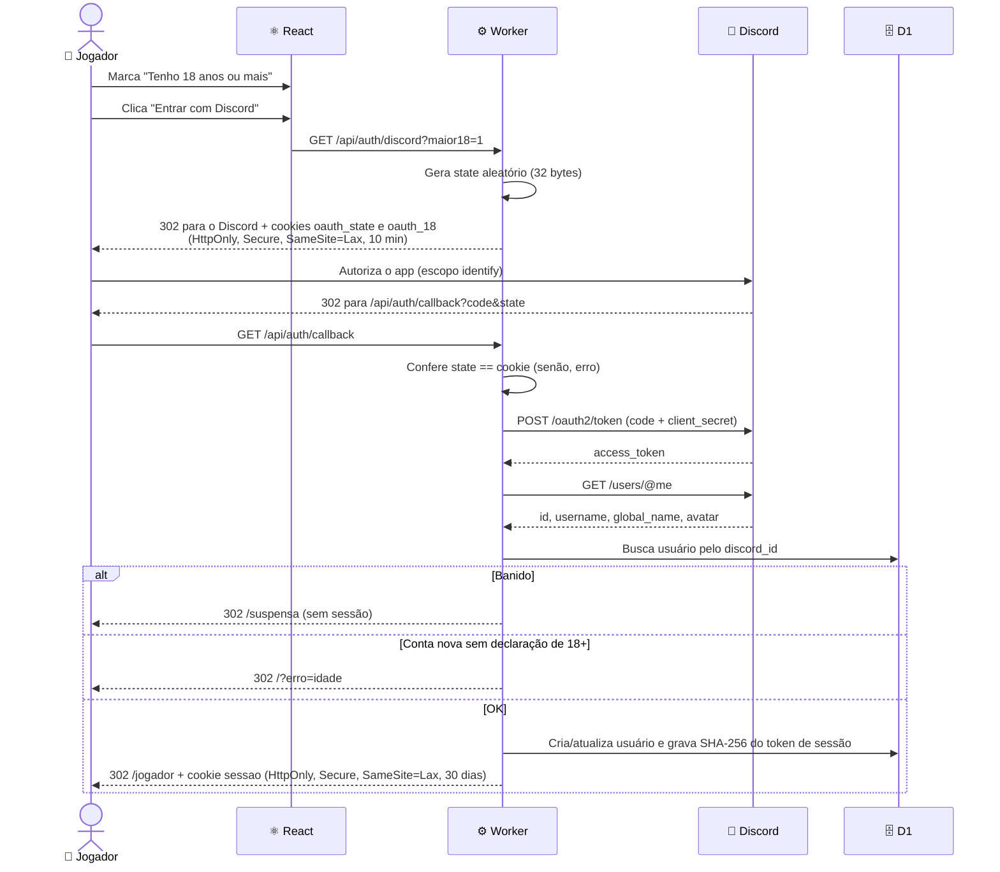
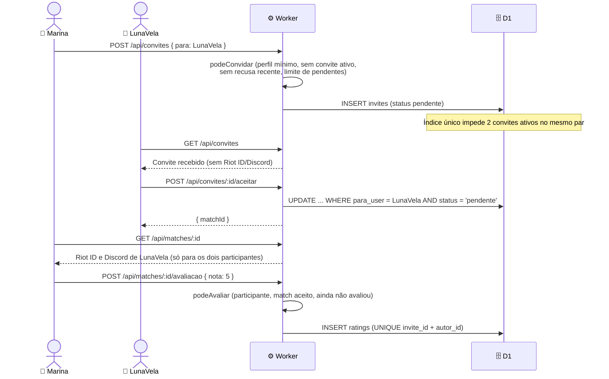
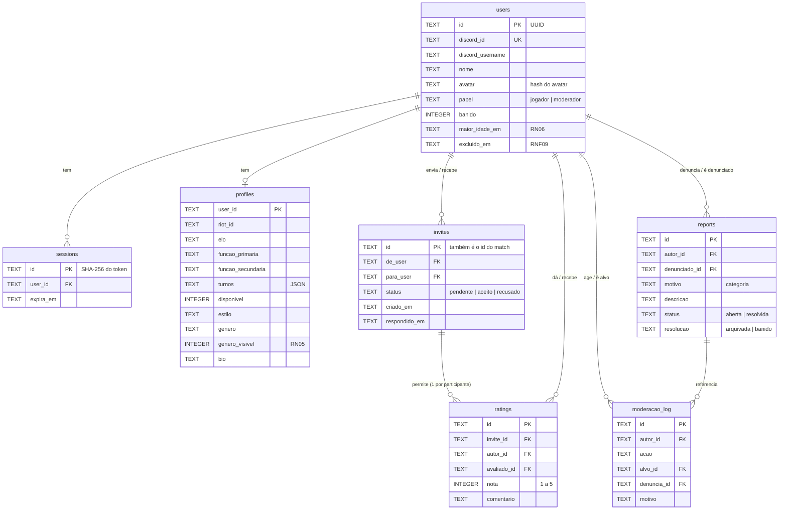

# 🏛️ Arquitetura do TeamUp

Este documento descreve a arquitetura técnica do TeamUp: visão geral, fluxos principais, modelo de dados, API,
regras de negócio, segurança da aplicação e as decisões técnicas por trás de cada escolha.

O pipeline de CI/CD e as práticas de segurança do ciclo de desenvolvimento estão em [DEVSECOPS.md](./DEVSECOPS.md).

---

## 📐 Visão Geral

O TeamUp é uma **SPA (React) servida pelo mesmo Cloudflare Worker que expõe a API**. Não existe servidor próprio:
o código roda na rede de borda da Cloudflare, perto de quem acessa, e o banco é o D1 (SQLite gerenciado).

```mermaid
graph LR
    Browser["🌐 Navegador<br/>(React SPA)"]
    Edge["☁️ Cloudflare Edge<br/>(HTTPS)"]
    Assets["📦 Assets estáticos<br/>(index.html, JS, CSS, fontes)"]
    Worker["⚙️ Worker<br/>(Hono · /api/*)"]
    D1["🗄️ Cloudflare D1<br/>(SQLite)"]
    Discord["🔐 Discord OAuth2"]

    Browser -->|HTTPS| Edge
    Edge -->|qualquer rota que não é /api| Assets
    Edge -->|/api/*| Worker
    Worker -->|prepare().bind()| D1
    Worker -->|troca code por token<br/>e lê /users/@me| Discord
    Browser -->|redirect de login| Discord

    style Browser fill:#e1f5ff
    style Worker fill:#f38020,color:#fff
    style D1 fill:#f38020,color:#fff
    style Edge fill:#1e1e1e,color:#fff
    style Discord fill:#5865f2,color:#fff
```

### Camadas

1. **Apresentação (navegador)**: React 19 renderiza as telas; React Router faz a navegação sem recarregar a página.
2. **Borda (Cloudflare)**: termina o HTTPS e decide o destino da requisição. `run_worker_first: ["/api/*"]` manda a
   API para o Worker; o resto é servido como arquivo estático, com *fallback* para `index.html` (SPA).
3. **API (Worker + Hono)**: middlewares de segurança, sessão e autorização; uma rota por caso de uso.
4. **Regras de negócio (`worker/rules.ts`)**: funções puras, sem I/O, testadas isoladamente.
5. **Dados (D1)**: SQLite com migrations versionadas; um banco por ambiente.
6. **Identidade (Discord)**: provedor OAuth2 externo; o TeamUp não guarda senha.

### Um Worker, três ambientes

| Ambiente | Worker | Banco D1 | Quem usa |
|----------|--------|----------|----------|
| local | `workerd` via Vite | `.wrangler/state` (arquivo local) | Quem está desenvolvendo |
| staging | `teamup-staging` | `teamup-staging` | O time, para testar antes de liberar |
| production | `teamup` | `teamup-production` | Os jogadores |

O ambiente é escolhido no **build** (`vite build --mode staging|prod`, que lê `CLOUDFLARE_ENV` de `.env.staging` /
`.env.prod`). O `wrangler.jsonc` define os bindings de cada um.

---

## 🔐 Fluxo de Login (Discord OAuth2)



### Por que guardar o hash do token, e não o token?

O cookie `sessao` leva 32 bytes aleatórios. No D1 fica só o **SHA-256** desse valor. Se o banco vazar, quem tiver a
cópia não consegue montar um cookie válido. Como o token tem alta entropia, um hash rápido (SHA-256) é suficiente e
cabe no limite de 10 ms de CPU por requisição do plano gratuito, ao contrário de bcrypt/argon2.

### Papel do usuário em cada requisição

O middleware `exigirSessao` (`worker/sessao.ts`) busca a sessão, recusa banidos (apagando as sessões deles) e calcula
o **papel efetivo**:

- **admin** se o `discord_id` está em `ADMIN_DISCORD_IDS` (configuração, muda só por PR);
- **moderador** se `users.papel = 'moderador'`;
- **jogador** nos outros casos.

Como o papel é calculado a cada requisição, promover, remover ou banir vale na hora, sem novo login.

---

## 🤝 Fluxo de Convite, Match e Avaliação



Um terceiro que tente abrir `/api/matches/:id` recebe **404**, e não 403: a resposta não revela que o match existe.

---

## 🗄️ Modelo de Dados



### Migrations

| Migration | O que adiciona |
|-----------|----------------|
| `0001_init` | Tabelas `users`, `sessions`, `profiles`, `invites`, `ratings`, `reports` |
| `0002_login_discord` | `users.avatar`, `users.maior_idade_em`, índice de expiração de sessão |
| `0003_perfil_gamer` | `profiles.disponivel`, `profiles.genero_visivel` |
| `0004_convites_match` | `invites.respondido_em`, índices e **índice único parcial** de convite ativo por par |
| `0005_papeis_moderacao` | `users.papel` e tabela `moderacao_log` |
| `0006_denuncias` | `reports.descricao`, `resolucao`, `resolvido_em`, `resolvido_por` |
| `0007_exclusao_conta` | `users.excluido_em` |

Regra do time: **migration só adiciona** (colunas, tabelas, índices). Nada é renomeado ou apagado, para que a versão
anterior do código continue funcionando enquanto o deploy acontece (as migrations rodam antes do deploy do Worker).

---

## 🔌 API

Todas as rotas ficam sob `/api`. Respostas de erro são sempre JSON genérico (`{ "error": "codigo" }`), sem stack trace.

| Método e rota | Acesso | Função |
|---------------|--------|--------|
| `GET /health` | Público | Health check (smoke test e probes do Kubernetes) |
| `GET /auth/discord`, `GET /auth/callback` | Público | Login OAuth2 (RF01) |
| `POST /auth/logout` | Público | Encerra a sessão |
| `GET /me` | Sessão | Dados do próprio usuário, papel e convites pendentes |
| `POST /me/excluir` | Sessão | Exclui (anonimiza) a própria conta (RNF09) |
| `GET /perfil` | Sessão | Perfil próprio + etapas concluídas + busca liberada (RF02, RF03, RN01) |
| `PUT /perfil/{jogos,nivel,horarios,estilo}` | Sessão | Salva uma etapa (RF02, RF04, RN05) |
| `GET /jogadores` | Sessão + perfil mínimo | Busca com filtros (RF05, RN03, RN05) |
| `GET /jogadores/:id` | Sessão | Perfil público, reputação e relação com quem vê (RF06) |
| `GET /convites`, `POST /convites` | Sessão | Lista e envia convites (RF07, RF08) |
| `POST /convites/:id/aceitar` · `/recusar` | Quem recebeu | Responde o convite (RF08) |
| `GET /matches`, `GET /matches/:id` | Participantes | Histórico e contatos do parceiro (RF09, RN02) |
| `POST /matches/:id/avaliacao` | Participantes | Avaliação de 1 a 5 (RF10, RN04) |
| `POST /denuncias` | Sessão | Denuncia um jogador (RF11) |
| `GET /moderacao`, `POST /moderacao/...` | Moderador ou admin | Denúncias, arquivar, banir; desbanir só admin (RF12, RN07) |
| `GET /equipe`, `POST /equipe/moderadores...` | Admin | Gestão de moderadores e histórico |

### Ordem dos middlewares (`worker/index.ts`)

1. `secureHeaders()`: CSP, `X-Frame-Options`, `nosniff`, HSTS e afins em toda resposta da API.
2. `csrf()`: recusa POST de formulário vindo de outra origem.
3. Sessão: toda rota exige sessão, exceto `/api/health` e `/api/auth/*` (`rotaPublica`).
4. Rota: valida a entrada com Zod, aplica a regra de negócio e acessa o D1 com SQL parametrizado.
5. `onError`: erros esperados mantêm o status com corpo genérico; o resto vira 500 sem detalhes.

---

## 📏 Regras de Negócio → Código

| Requisito | Função (`worker/rules.ts`) | Usada em |
|-----------|----------------------------|----------|
| RN01 perfil mínimo | `perfilCompleto` | `perfil.ts`, `jogadores.ts`, `convites.ts` |
| RF03 checklist | `etapasConcluidas`, `proximaEtapa` | `perfil.ts` |
| RF02 Riot ID | `riotIdValido` | `perfil.ts` |
| RF04 funções | `funcoesValidas` | `perfil.ts` |
| RN03 complementar | `funcaoComplementar` | busca (`jogadores.ts`) |
| RN05 gênero | `generoParaSalvar` | `perfil.ts` |
| RF05 elo e ordenação | `faixaElo`, `compatibilidade` | `jogadores.ts` |
| Nota pública (3+) | `notaPublica` | `jogadores.ts`, `convites.ts` |
| RN06 / RN07 login | `decidirLogin` | `auth.ts` |
| RNF04 rotas públicas | `rotaPublica` | `index.ts` |
| RF07 convite | `podeConvidar` | `convites.ts` |
| RF10 / RN04 avaliação | `notaValida`, `podeAvaliar` | `convites.ts` |
| Papéis | `listaAdmins`, `papelEfetivo`, `podeModerar`, `podeMudarModerador` | `sessao.ts`, `equipe.ts` |
| RF11 denúncia | `podeDenunciar` | `moderacao.ts` |
| RF12 / RN07 banimento | `podeBanir`, `podeDesbanir` | `moderacao.ts` |
| RNF09 exclusão | `dadosAnonimizados` | `index.ts` |

---

## 🎨 Frontend

### Rotas

| Rota | Tela | Acesso |
|------|------|--------|
| `/` | Entrar | Público |
| `/termos`, `/privacidade` | Termos de uso, Política de privacidade | Público |
| `/suspensa` | Conta suspensa | Público |
| `/jogador` | Área do Jogador | Sessão |
| `/perfil/:etapa` | Onboarding (jogos, nivel, horarios, estilo) | Sessão |
| `/buscar` | Buscar duo | Sessão + perfil mínimo |
| `/jogadores/:id` | Perfil público | Sessão |
| `/convites` | Caixa de convites | Sessão |
| `/matches`, `/matches/:id`, `/matches/:id/avaliar` | Matches, Deu match!, Avaliar | Participantes |
| `/moderacao` | Painel de moderação | Moderador ou admin |
| `/moderacao/equipe` | Equipe | Admin |

As telas que exigem sessão usam o hook `useProtegido`: sem sessão (401) voltam para a entrada; banido (403) vai para
`/suspensa`; 404 e falha de rede têm telas próprias. A autorização real é sempre do servidor; o front só esconde o
que a pessoa não pode usar.

### Design system

- **Tokens** em `src/index.css` (`@theme` do Tailwind): cores (`fundo`, `superficie`, `destaque`, `perigo`...),
  escala tipográfica e raios, extraídos do protótipo do Figma. Componentes não usam valores soltos.
- **Componentes base** em `src/components/`: `Botao` (primário, secundário, perigo), `Cartao`, `Aviso`, `Modal` e
  `Folha` (`<dialog>` nativo), `Opcoes` (radios/checkboxes com visual de chip), `Interruptor` (`role="switch"`),
  `Campo`, `EscolhaEstrelas`...
- **Mobile-first**: navegação no topo no desktop e barra fixa embaixo no celular.
- **Acessibilidade**: inputs nativos, `label` em todo campo, foco visível, `aria-live` nas mensagens, contraste AA.

---

## 🔒 Segurança na Aplicação

| Ameaça | Mitigação |
|--------|-----------|
| SQL injection | Só `prepare().bind()`; listas via `json_each(?)`; nenhum SQL montado com strings |
| Entrada maliciosa | Zod em toda rota (enums, tamanhos máximos, UUID nos ids) |
| Sequestro de sessão | Token de 32 bytes, cookie `HttpOnly; Secure; SameSite=Lax`, hash no banco, expiração |
| Login forjado (OAuth) | `state` aleatório em cookie, conferido no callback |
| CSRF | `SameSite=Lax` + middleware `csrf()` do Hono |
| XSS | React escapa por padrão; CSP sem scripts de terceiros (`public/_headers`) |
| Clickjacking | `frame-ancestors 'none'` e `X-Frame-Options: DENY` |
| Vazamento de contatos | Riot ID/Discord só em `/api/matches/:id` para os dois participantes (RN02) |
| Enumeração de recursos | 404 para o que a pessoa não pode ver (matches, convites alheios) |
| Abuso | Limites de convites pendentes, de denúncias por dia e espera após recusa |
| Escalada de privilégio | Admin só por configuração; papel calculado no servidor; hierarquia em `podeBanir` |
| Conta banida ativa | Sessões apagadas no banimento e conferência a cada requisição |

---

## 🧭 Decisões Técnicas

### Por que Cloudflare Workers + D1?
O plano gratuito cobre o MVP (100 mil requisições/dia), o deploy é um comando e frontend e API ficam no mesmo
domínio. Isso dispensa CORS e permite cookie `SameSite` sem configuração extra. O D1 é SQLite: simples de testar
localmente e com migrations nativas no Wrangler.

### Por que Hono e não Express?
O Express depende de APIs do Node que o runtime do Workers não tem. O Hono foi feito para Workers, é pequeno e tem
middlewares prontos de segurança (`secureHeaders`, `csrf`, cookies).

### Por que SQL sem ORM?
O banco é pequeno e as consultas são poucas e conhecidas. Com SQL literal e `bind`, fica claro o que roda, é fácil de
revisar no PR e o Semgrep consegue analisar sem falso negativo. Por isso o projeto evita montar SQL com template
strings, mesmo com constantes.

### Por que admins por configuração?
Uma mudança de admin passa por PR, revisão e pipeline, e fica registrada no Git. Se uma conta de moderador for
comprometida, ela não consegue se promover nem remover os admins.

### Por que anonimizar em vez de apagar ao excluir a conta?
`ratings` tem `ON DELETE CASCADE`: apagar o usuário apagaria as avaliações que ele deu e mudaria a reputação de outras
pessoas. A exclusão remove os dados pessoais e deixa os registros como "Conta excluída".

### Por que Docker e Kubernetes se produção é serverless?
Só para o **DAST**: o ZAP precisa atacar uma instância rodando. A imagem executa o Worker no `workerd` (o mesmo runtime
de produção) com D1 local, num cluster `kind` que existe apenas durante o job do CI. Veja [DEVSECOPS.md](./DEVSECOPS.md).

### Limites do plano gratuito
- 10 ms de CPU por requisição: nada de hash de senha ou processamento pesado por request.
- O WAF da Cloudflare exige domínio próprio; com `*.workers.dev`, as proteções ficam na aplicação. Quando houver
  domínio, produção passa a usar `custom_domain` com `workers_dev: false` (instruções no `wrangler.jsonc`).
