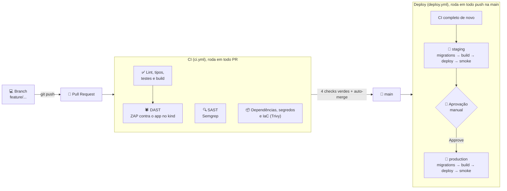
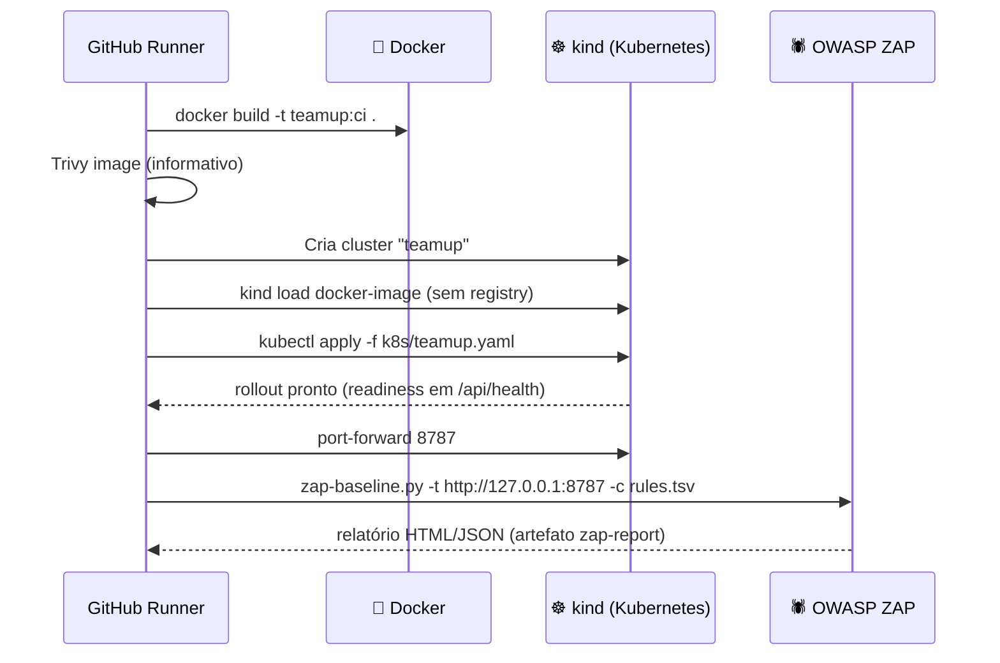
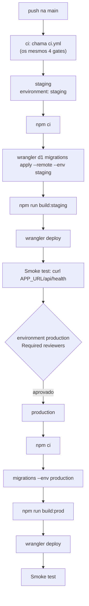

# 🛡️ DevSecOps do TeamUp

Este documento explica como o código sai da máquina de quem desenvolve e chega à produção: o fluxo de trabalho com Git,
os workflows do GitHub Actions, cada gate de segurança, os ambientes, a gestão de segredos, a segurança em runtime e
como operar (deploy, rollback, problemas comuns).

A ideia central é **segurança em todas as etapas**: nenhum código chega à `main` sem passar por qualidade, SAST, SCA,
scan de segredos e IaC e DAST, e nada chega à produção sem passar por staging e por uma aprovação humana.

---

## 🗺️ Visão geral do pipeline



| Etapa | Onde | Bloqueia? |
|-------|------|-----------|
| Lint, tipos, testes, build | `ci.yml` → `quality` | Sim |
| SAST (Semgrep) | `ci.yml` → `sast` | Sim (achados WARNING/ERROR) |
| SCA, segredos e IaC (Trivy) | `ci.yml` → `sca` | Sim (HIGH/CRITICAL com correção) |
| Scan da imagem (Trivy) | `ci.yml` → `dast` | Não (informativo) |
| DAST (OWASP ZAP) | `ci.yml` → `dast` | Sim (regras marcadas FAIL) |
| Merge na `main` | Ruleset `proteger-main` | Exige PR e os 4 checks |
| Staging | `deploy.yml` → `staging` | Smoke test precisa responder |
| Produção | `deploy.yml` → `production` | Exige aprovação no environment |

---

## 🔀 Fluxo de trabalho

1. **Uma tarefa = uma branch = um PR pequeno.** Branches `feature/...`, `fix/...`, `docs/...`, `chore/...`.
2. **Conventional Commits** (`feat:`, `fix:`, `docs:`, `chore:`), citando os requisitos (RFxx, RNxx).
3. Antes de subir: `npm run lint`, `npm run typecheck`, `npm test`, `npm run build`.
4. O PR dispara o CI. Com **Enable auto-merge**, o merge acontece sozinho quando os 4 checks ficam verdes (e a aprovação,
   quando o ruleset exigir).
5. O merge na `main` dispara o deploy: staging é atualizado automaticamente e produção espera aprovação.

### Proteção da `main` (ruleset `proteger-main`)

| Regra | Efeito |
|-------|--------|
| Require a pull request before merging | Ninguém faz push direto na `main` |
| Require status checks to pass | Os 4 jobs do CI precisam passar: `Lint, tipos, testes e build`, `SAST (Semgrep)`, `Dependências, segredos e IaC (Trivy)`, `DAST (ZAP contra o app no kind)` |
| Block force pushes | O histórico da `main` não pode ser reescrito |

> O auto-merge usa o recurso nativo do GitHub. Merges feitos por bots com o `GITHUB_TOKEN` **não disparam** outros
> workflows, e o deploy não aconteceria.

---

## ⚙️ Workflow de CI (`.github/workflows/ci.yml`)

Roda em todo PR para a `main` e também é chamado pelo deploy (`workflow_call`). Um push novo no mesmo PR cancela a
execução anterior (`concurrency` com `cancel-in-progress`).

### 1. ✅ Qualidade: `Lint, tipos, testes e build`

```text
npm ci → npm run lint → npm run typecheck → npm test → npm run build
```

- `npm ci` instala exatamente o que está no `package-lock.json` (build reproduzível).
- **ESLint** (typescript-eslint + react-hooks) e **TypeScript** em modo `strict` no front e no Worker.
- **Vitest**: testes das regras de negócio em `worker/rules.test.ts`.
- **Build**: garante que o projeto compila para o Worker e para os estáticos.

### 2. 🔍 SAST: `SAST (Semgrep)`

- Roda no container oficial `semgrep/semgrep` (versão fixa).
- Regras: `p/default`, `p/typescript` e `p/react` (injeção, XSS, segredos no código, uso perigoso de APIs).
- Bloqueia achados de severidade **WARNING** e **ERROR**; achados INFO (estilo) não quebram o PR.
- Gera **SARIF** e publica na aba *Security* do GitHub quando o repositório é público.
- Consequência no código: o SQL é sempre literal com `bind`. Nem constantes são interpoladas em consultas, para não
  gerar falso positivo nem esconder um problema real.

### 3. 📦 SCA, segredos e IaC: `Dependências, segredos e IaC (Trivy)`

Um único `trivy fs` cobre três frentes:

| Scanner | O que procura |
|---------|---------------|
| `vuln` | CVEs nas dependências do `package-lock.json` |
| `secret` | Chaves, tokens e senhas commitados por engano |
| `misconfig` | Más configurações no `Dockerfile` e nos manifests de `k8s/` |

Bloqueia **HIGH** e **CRITICAL** que já têm correção disponível (`ignore-unfixed`), para o time agir no que é acionável.

### 4. 🕷️ DAST: `DAST (ZAP contra o app no kind)`

O DAST precisa de uma **instância rodando** para atacar. Como produção é serverless, o CI sobe uma réplica fiel do app
num Kubernetes efêmero:



- **A imagem** (`Dockerfile`) roda o Worker no `workerd` (o mesmo runtime da Cloudflare) via `vite preview`, com D1
  local e as migrations aplicadas na subida. Ela existe **só para o teste**: nunca vai para um registry nem para produção.
- **O ZAP baseline** faz spider e análise passiva: headers de segurança, cookies, CSP, CORS, vazamento de informação.
- **`.zap/rules.tsv`** define o que quebra o build:

| Nível | Regras |
|-------|--------|
| **FAIL** (bloqueia) | Falta de anti-clickjacking, `X-Content-Type-Options`, CSP, CORS mal configurado, cookie sem `HttpOnly` ou sem `Secure` |
| **WARN** | Cookie sem `SameSite`, CSP com curinga ou `unsafe-inline` |
| **IGNORE** | HSTS (o teste roda em HTTP local), comentários e timestamps no bundle minificado, alertas informativos |

- Se o job falhar, o passo **Diagnóstico do cluster** imprime pods, eventos e logs para facilitar a investigação.

### Hardening do ambiente de teste

| Onde | Medida |
|------|--------|
| `Dockerfile` | Multi-stage (build separado do runtime), base `node:22-bookworm-slim`, roda como usuário `node` (não root) |
| `k8s/teamup.yaml` | `runAsNonRoot`, `readOnlyRootFilesystem`, `allowPrivilegeEscalation: false`, `capabilities: drop ALL`, `seccompProfile: RuntimeDefault`, sem token de service account, limites de CPU e memória, probes em `/api/health` |
| `imagePullPolicy: Never` | A imagem vem do `kind load`, nunca de um registry externo |

---

## 🚀 Workflow de Deploy (`.github/workflows/deploy.yml`)

Roda a cada push na `main` (ou manualmente, por `workflow_dispatch`).



- **O CI roda de novo na `main`**: garante que o código mesclado (e não só o do PR) passou pelos gates.
- **Migrations antes do deploy**: o banco ganha as colunas novas antes do código que as usa. Por isso toda migration
  **só adiciona**, para continuar compatível com a versão anterior do Worker durante a troca.
- **Smoke test**: `curl --retry 5` em `APP_URL/api/health`. Se o Worker novo não responder, o job falha.
- **Aprovação de produção**: o environment `production` tem *Required reviewers*. O job fica em *Waiting* até alguém
  clicar em **Review deployments → Approve and deploy**.
- **Concorrência por ambiente** (`deploy-staging`, `deploy-production`): um deploy de produção esperando aprovação
  não trava o staging dos pushes seguintes. Se chegar um push novo, o deploy pendente mais antigo do mesmo ambiente
  é substituído.
- `WRANGLER_SEND_METRICS=false`: o Wrangler não envia telemetria a partir do CI.

---

## 🔗 Cadeia de suprimentos (supply chain)

| Prática | Por quê |
|---------|---------|
| **Actions fixadas por SHA** (`uses: actions/checkout@<sha> # v7.0.1`) | Tags podem ser reescritas por quem compromete o repositório da action (caso da `trivy-action` em mar/2026). O SHA é imutável |
| **`permissions: contents: read`** por padrão | O `GITHUB_TOKEN` só ganha mais permissão onde precisa (`security-events: write` no Semgrep) |
| **`persist-credentials: false`** no checkout | O token não fica salvo no `.git` para os passos seguintes |
| **`npm ci` com lockfile** | Sem versões flutuantes no CI |
| **Ferramentas com versão fixa** | Semgrep `1.180.0`, Trivy `v0.70.0` |
| **Dependabot semanal** | Um PR agrupado por ecossistema (npm, GitHub Actions, imagem Docker), que passa pelos mesmos gates |
| **Majors controlados** | TypeScript e Node não sobem major automaticamente (dependem do typescript-eslint e de o Node ser LTS) |

---

## 🔑 Gestão de segredos

Nenhum segredo fica no repositório. O Trivy (`secret`) e o Semgrep conferem isso em todo PR.

| Segredo / configuração | Onde fica | Quem usa |
|------------------------|-----------|----------|
| `DISCORD_CLIENT_SECRET` (local) | `.dev.vars` (no `.gitignore`) | `npm run dev` |
| `DISCORD_CLIENT_SECRET` (staging/produção) | `wrangler secret put --env ...` (cifrado na Cloudflare) | Worker |
| `CLOUDFLARE_API_TOKEN` | GitHub → Environments → secret (por ambiente) | Jobs de deploy |
| `CLOUDFLARE_ACCOUNT_ID` | GitHub → Environments → secret | Jobs de deploy |
| `APP_URL` | GitHub → Environments → variável | Smoke test |
| `DISCORD_CLIENT_ID`, `ADMIN_DISCORD_IDS` | `wrangler.jsonc` (públicos, versionados de propósito) | Worker |

- O token da Cloudflare segue o **menor privilégio**: modelo *Edit Cloudflare Workers* + *Account → D1 → Edit*,
  restrito à conta do projeto.
- Os secrets dos environments só são entregues aos jobs daquele environment. O de produção, só depois da aprovação.

---

## 🧱 Segurança em runtime

### Headers

| Origem | Headers |
|--------|---------|
| Estáticos (`public/_headers`) | `Content-Security-Policy`, `X-Frame-Options: DENY`, `X-Content-Type-Options: nosniff`, `Referrer-Policy`, `Permissions-Policy`, `Strict-Transport-Security`, `Cross-Origin-Opener-Policy` |
| API (`secureHeaders()` do Hono) | O mesmo conjunto em todas as respostas de `/api/*` |

A CSP só permite recursos do próprio domínio (`default-src 'self'`); a única exceção são os avatares de
`cdn.discordapp.com`. Fontes e ícones são empacotados no build.

### Aplicação

- **Sessão**: cookie `HttpOnly; Secure; SameSite=Lax`, token de 32 bytes, hash SHA-256 no banco, expiração de 30 dias.
- **OAuth**: `state` aleatório conferido no callback; escopo mínimo `identify`.
- **CSRF**: `SameSite=Lax` + middleware `csrf()`.
- **Autorização por recurso** no servidor (contatos só no match, painel só para a equipe, admin por configuração).
- **Validação** de toda entrada com Zod e **SQL parametrizado**.
- **Erros genéricos**: nada de stack trace na resposta; detalhes só no log do Worker.
- **Limites anti-abuso**: convites pendentes, espera após recusa, denúncias por dia.
- **Banimento imediato**: as sessões do banido são apagadas e a conferência ocorre a cada requisição.
- **Auditoria**: toda ação da equipe vai para `moderacao_log` (quem, o quê, contra quem, quando e motivo).

### Observabilidade

`observability.enabled` no `wrangler.jsonc` liga os logs do Worker no painel da Cloudflare
(*Workers & Pages → teamup → Logs*). Erros inesperados são registrados com `console.error` no `onError`.

---

## 🧯 Operação

### Rollback

| Situação | Como voltar |
|----------|-------------|
| Código com problema em produção | `npx wrangler rollback --env production` volta para a versão anterior do Worker na hora; depois, corrija com um PR |
| Correção definitiva | `git revert` do commit no GitHub (via PR); o pipeline publica a reversão |
| Dados corrompidos no D1 | `npx wrangler d1 time-travel restore teamup-production --timestamp=<ISO>` restaura o banco para um momento anterior |

Como as migrations só adicionam, voltar o Worker para a versão anterior não quebra o banco.

### Configuração inicial (uma vez, pelo dono do repositório)

1. **Cloudflare**: `npx wrangler login`, `npx wrangler d1 create teamup-staging` e `teamup-production`, IDs colados no
   `wrangler.jsonc`.
2. **Token**: *My Profile → API Tokens → Edit Cloudflare Workers* + *Account → D1 → Edit*.
3. **GitHub → Settings → Environments**: `staging` e `production` com `CLOUDFLARE_API_TOKEN`, `CLOUDFLARE_ACCOUNT_ID`
   e `APP_URL`; em `production`, marcar *Required reviewers*.
4. **Discord Developer Portal**: redirects de `localhost`, staging e produção (`/api/auth/callback`).
5. **Secrets do app**: `npx wrangler secret put DISCORD_CLIENT_SECRET --env staging` (e `--env production`).
6. **Settings → General → Pull Requests**: *Allow auto-merge*. **Rules → Rulesets**: `proteger-main`.

### Problemas comuns

| Sintoma | Causa provável e solução |
|---------|--------------------------|
| `Authentication error [code: 10000]` no Actions | Token errado ou sem permissão de D1: confira os secrets do environment |
| "Smoke test" falhou | `APP_URL` errada ou com barra no final |
| `production` parado em *Waiting* | Normal: falta aprovar em *Review deployments* |
| Push recusado com "protected branch" | Normal: crie uma branch e abra PR |
| `npm ci` com `ERESOLVE` num PR do Dependabot | Major incompatível (ex.: TypeScript novo sem suporte no typescript-eslint): feche o PR |
| Falha no Semgrep, Trivy ou ZAP | Abra o job no Actions; o ZAP deixa o relatório no artefato `zap-report` |
| Login cai em `/?erro=falha` | Redirect não cadastrado no Discord ou `DISCORD_CLIENT_SECRET` ausente no ambiente |

---

## 🧭 Melhorias futuras

- **Domínio próprio + WAF**: com a zona na Cloudflare, `custom_domain` e `workers_dev: false`, o WAF e as regras de
  rate limiting passam a ficar na frente do Worker.
- **Testes de integração da API** com `@cloudflare/vitest-pool-workers` (rotas + D1 reais no CI).
- **DAST autenticado**: ZAP com uma sessão de teste para cobrir as rotas logadas.
- **Assinatura de commits** e verificação no ruleset.
